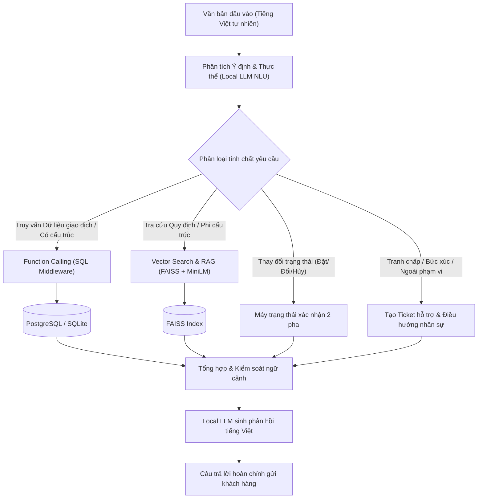
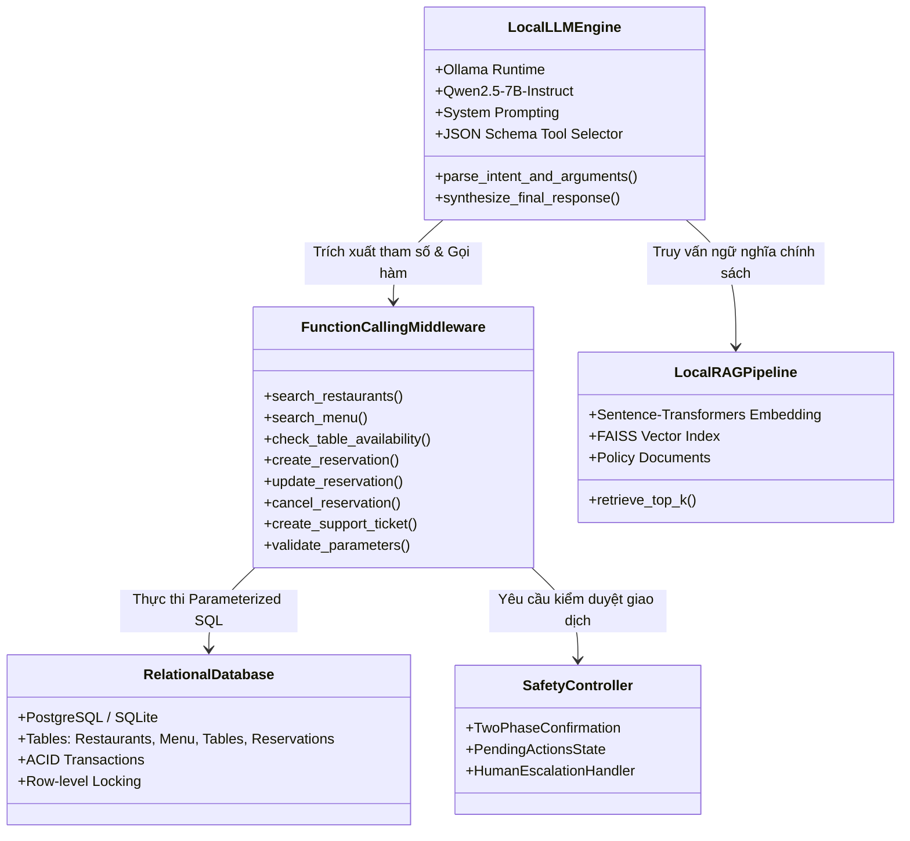
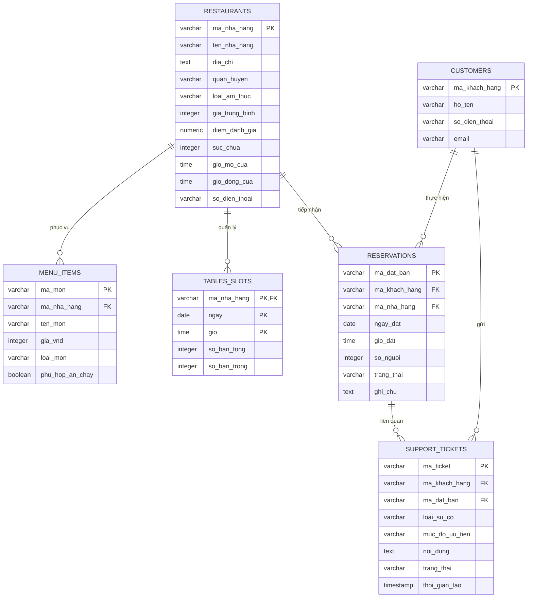
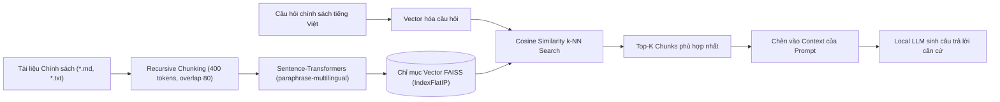
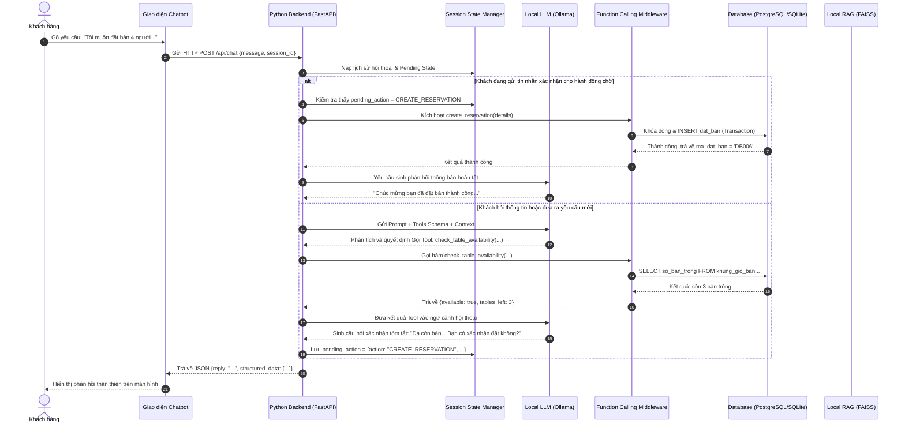
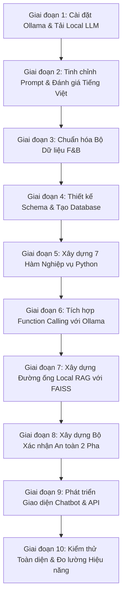
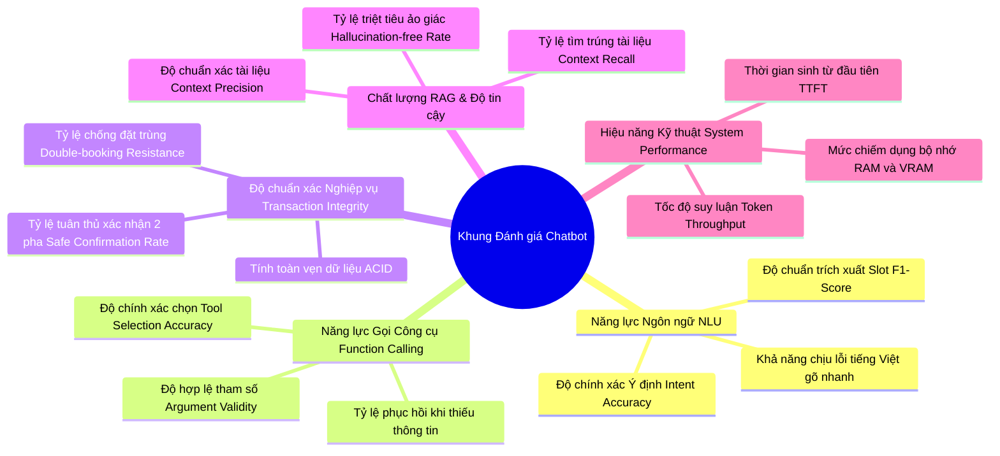

# BÁO CÁO NGHIÊN CỨU VÀ PHÁT TRIỂN ĐỀ TÀI

# HỆ THỐNG CHATBOT HỖ TRỢ ĐẶT BÀN VÀ CHĂM SÓC KHÁCH HÀNG NHÀ HÀNG SỬ DỤNG MÔ HÌNH NGÔN NGỮ LỚN CHẠY CỤC BỘ (LOCAL LLM)

**Ngành:** Công nghệ Thông tin  
**Lĩnh vực nghiên cứu:** Trí tuệ nhân tạo (AI), Xử lý ngôn ngữ tự nhiên (NLP), Hệ thống hội thoại thông minh (Conversational AI)  
**Môi trường thực thi mô hình:** Cục bộ (Local On-Premise / Edge Computing qua Ollama)  
**Ngôn ngữ lập trình chính:** Python  

---

## MỤC LỤC TỔNG QUAN

1. **Chương 1: Giới thiệu tổng quan (Introduction)**
   - 1.1. Đề tài là gì? (What?)
   - 1.2. Tại sao thực hiện đề tài? (Why?)
   - 1.3. Mục tiêu, phạm vi và ý nghĩa của đề tài
   - 1.4. Lý do lựa chọn mô hình chạy cục bộ (Local LLM) thay vì dịch vụ đám mây (Cloud LLM API)
2. **Chương 2: Phát biểu bài toán (Problem Statement)**
   - 2.1. Đầu vào và đầu ra của hệ thống
   - 2.2. Các bài toán kỹ thuật cần giải quyết
   - 2.3. Ràng buộc về tính toàn vẹn và độ chính xác dữ liệu
   - 2.4. Cơ chế xác nhận an toàn hai pha (Safe Two-Phase Confirmation)
   - 2.5. Khả năng hiểu và xử lý tiếng Việt tự nhiên đa dạng
3. **Chương 3: Tổng quan các nghiên cứu liên quan (Review of Related Work)**
   - 3.1. Hướng tiếp cận 1: Chatbot dựa trên luật (Rule-based Chatbots)
   - 3.2. Hướng tiếp cận 2: Phân loại ý định và điền thông tin (NLU: Intent Classification & Slot Filling)
   - 3.3. Hướng tiếp cận 3: Mô hình ngôn ngữ lớn độc lập (Standalone LLMs)
   - 3.4. Hướng tiếp cận 4: Mô hình ngôn ngữ lớn cục bộ kết hợp Gọi công cụ và RAG (Local LLM + Function Calling + RAG)
   - 3.5. Bảng so sánh tổng hợp các hướng tiếp cận và lập luận lựa chọn
4. **Chương 4: Phương pháp đề xuất (Methodology)**
   - 4.1. Bộ máy suy luận cục bộ (Local LLM Engine: Qwen vs Llama & Ollama Runtime)
   - 4.2. Cơ chế gọi công cụ nghiệp vụ (Function Calling / Tool Use) và danh mục hàm chuẩn hóa
   - 4.3. Thiết kế cơ sở dữ liệu quan hệ (Relational Database Design) và kiểm soát giao dịch ACID
   - 4.4. Hệ thống tra cứu văn bản tăng cường (Local Retrieval-Augmented Generation - RAG)
   - 4.5. Cơ chế tương tác có con người giám sát (Human-in-the-loop) và điều hướng khiếu nại (Escalation)
5. **Chương 5: Kiến trúc hệ thống (System Architecture)**
   - 5.1. Sơ đồ kiến trúc phân tầng tổng thể (Multi-tiered Architecture)
   - 5.2. Luồng hoạt động chi tiết (End-to-End Execution Flow)
   - 5.3. Phân định ranh giới trách nhiệm (Separation of Concerns)
6. **Chương 6: Lộ trình và phương pháp triển khai (Implementation Plan)**
   - Lộ trình 10 giai đoạn từ cài đặt môi trường, phát triển backend đến kiểm thử hoàn thiện
7. **Chương 7: Phương pháp và tiêu chí đánh giá (Evaluation Framework)**
   - 7.1. Các tiêu chí và chỉ số định lượng
   - 7.2. Thiết kế bộ dữ liệu kiểm thử chuẩn (Benchmark Test Suite)
   - 7.3. Quy trình đo lường thực nghiệm
8. **Tài liệu tham khảo (References)**

---

## CHƯƠNG 1: TỔNG QUAN ĐỀ TÀI (INTRODUCTION)

### 1.1. Đề tài là gì? (What?)
Đề tài **"Hệ thống chatbot hỗ trợ đặt bàn và chăm sóc khách hàng nhà hàng sử dụng mô hình ngôn ngữ lớn chạy cục bộ (Local LLM)"** là một giải pháp ứng dụng trí tuệ nhân tạo toàn diện. Hệ thống cho phép khách hàng tương tác tự nhiên bằng tiếng Việt để tìm kiếm thông tin ẩm thực, tra cứu thực đơn, kiểm tra bàn trống theo thời gian thực, đặt bàn mới, thay đổi giờ hẹn, hủy bàn, tra cứu các chính sách hoạt động của nhà hàng và gửi phản ánh, khiếu nại.

Điểm khác biệt cốt lõi của đề tài nằm ở việc **vận hành hoàn toàn tự chủ tại hạ tầng nội bộ (On-premise / Local Deployment)**:
- Mô hình ngôn ngữ lớn (LLM - *Large Language Model*) mã nguồn mở được tải về máy và chạy thông qua trình thực thi tối ưu **Ollama**.
- Hệ thống **tuyệt đối không sử dụng API bên ngoài** (như OpenAI GPT-4o, Google Gemini API, Claude API...).
- Việc xử lý hội thoại thông minh được kết hợp chặt chẽ giữa khả năng lập luận ngôn ngữ của LLM với **Cơ chế gọi hàm nội bộ (Function Calling / Tool Use)** trên cơ sở dữ liệu quan hệ (PostgreSQL / SQLite) và **Cơ chế tra cứu văn bản chính sách tăng cường (Local RAG)** sử dụng mô hình nhúng cục bộ (Sentence Transformers) kết hợp thư viện tìm kiếm vector nội bộ (FAISS).

### 1.2. Tại sao thực hiện đề tài? (Why?)
Ngành dịch vụ ăn uống và nhà hàng (F&B - *Food and Beverage*) tại Việt Nam đối mặt với các áp lực lớn trong khâu chăm sóc khách hàng:
1. **Quá tải đường dây và nhân sự vào giờ cao điểm:** Khách hàng thường tập trung gọi điện hoặc nhắn tin đặt bàn vào các khung giờ trưa (11:30 - 13:00) và chiều tối (17:30 - 19:30). Nhân viên phục vụ hoặc lễ tân thường xuyên bị quá tải, dẫn đến tình trạng trả lời chậm trễ, bỏ sót tin nhắn, hoặc ghi nhận nhầm lẫn số lượng khách và thời gian hẹn.
2. **Khách hàng mong muốn phản hồi tức thì 24/7:** Người tiêu dùng hiện đại có xu hướng tìm hiểu thông tin và lên kế hoạch ăn uống vào đêm muộn hoặc sáng sớm - những khoảng thời gian nhà hàng chưa có nhân viên trực tổng đài.
3. **Các giải pháp chatbot truyền thống còn cứng nhắc:** Các chatbot dựa trên kịch bản nút bấm (Button-based) hoặc quy tắc từ khóa (Rule-based) thường thất bại khi khách hàng gõ tiếng Việt tự nhiên, có dấu hoặc không dấu, dùng từ lóng, hoặc thay đổi ý định đột ngột trong quá trình hội thoại.
4. **Rào cản từ việc sử dụng Cloud LLM API thương mại:** Dù các dịch vụ đám mây như OpenAI hay Google Gemini có năng lực ngôn ngữ mạnh mẽ, nhưng việc ứng dụng chúng vào các doanh nghiệp F&B thực tế tại Việt Nam gặp phải các rào cản nghiêm trọng về chi phí tích lũy theo lượt truy vấn (Pay-per-token), rủi ro rò rỉ dữ liệu khách hàng theo quy định pháp lý, và sự phụ thuộc đường truyền Internet quốc tế.

Do đó, việc nghiên cứu xây dựng một hệ thống chatbot dựa trên **Mô hình ngôn ngữ lớn chạy cục bộ (Local LLM)** là nhu cầu cấp thiết, mang tính thời sự công nghệ và tính khả thi ứng dụng cao.

### 1.3. Mục tiêu, phạm vi và ý nghĩa của đề tài

#### Mục tiêu nghiên cứu
- **Mục tiêu khoa học:** Nghiên cứu và hiện thực hóa kiến trúc tác tử lai (Hybrid Conversational Agent) kết hợp giữa năng lực suy luận ngôn ngữ tự nhiên tiếng Việt của mô hình ngôn ngữ lớn mã nguồn mở chạy cục bộ với tính chính xác xác định (deterministic) của cơ sở dữ liệu quan hệ và hệ thống tra cứu tài liệu ngữ nghĩa cục bộ.
- **Mục tiêu kỹ thuật:** Triển khai thành công mô hình ngôn ngữ lớn mã nguồn mở (ưu tiên họ mô hình Qwen, đối sánh cùng Llama) trên môi trường Ollama; xây dựng tầng nghiệp vụ Python FastAPI xử lý Function Calling an toàn; tích hợp hệ thống RAG sử dụng Sentence Transformers và FAISS; đảm bảo tính toàn vẹn giao dịch đặt bàn.
- **Mục tiêu ứng dụng:** Xây dựng một sản phẩm hoàn chỉnh có giao diện người dùng trực quan, hỗ trợ đầy đủ các nghiệp vụ thực tế của nhà hàng: tìm quán, xem món, kiểm tra bàn, đặt bàn có xác nhận an toàn, đổi/hủy bàn và ghi nhận khiếu nại.

#### Phạm vi nghiên cứu
- **Phạm vi ngôn ngữ:** Tập trung xử lý tiếng Việt tự nhiên, bao gồm câu có dấu, không dấu, viết tắt thông dụng, và phương ngữ phổ biến trong giao tiếp ẩm thực tại Việt Nam.
- **Phạm vi nghiệp vụ:** Giới hạn trong chu trình hỗ trợ khách hàng nhà hàng bao gồm: Tra cứu địa điểm/thực đơn, Quản lý giao dịch đặt bàn (Đặt, Đổi, Hủy, Báo trễ), Tra cứu chính sách nhà hàng (Phí hủy, Giữ bàn, Trẻ em, Phòng VIP), và Chuyển tiếp nhân viên hỗ trợ khi xảy ra sự cố.
- **Phạm vi môi trường phần cứng:** Ưu tiên tối ưu hóa để hệ thống có thể vận hành ổn định trên máy tính cá nhân hoặc máy trạm phổ thông có card đồ họa tầm trung (GPU 8GB - 16GB VRAM) hoặc CPU đa luồng, làm tiền đề mở rộng lên máy chủ nội bộ của doanh nghiệp.

#### Ý nghĩa của đề tài
- **Ý nghĩa học thuật:** Đóng góp một thiết kế kiến trúc chuẩn mực và giải pháp thực nghiệm trong việc ứng dụng Local LLM xử lý ngôn ngữ tiếng Việt kết hợp Function Calling an toàn trong bài toán giao dịch cơ sở dữ liệu, một chủ đề đang được quan tâm sâu sắc trong cộng đồng trí tuệ nhân tạo ứng dụng.
- **Ý nghĩa thực tiễn:** Cung cấp giải pháp phần mềm độc lập, chi phí vận hành tiệm cận 0 đồng sau đầu tư ban đầu, giúp các chuỗi nhà hàng vừa và nhỏ (SMEs) dễ dàng số hóa quy trình tiếp nhận khách hàng mà vẫn làm chủ hoàn toàn dữ liệu.

### 1.4. Lý do lựa chọn Local LLM thay vì Cloud LLM API

| Tiêu chí | Cloud LLM API (OpenAI / Gemini) | Local LLM (Ollama: Qwen / Llama) | Phân tích lợi thế của Local LLM trong đề tài |
|---|---|---|---|
| **Bảo mật và Quyền riêng tư (Data Privacy)** | Dữ liệu hội thoại, số điện thoại, tên khách hàng và thói quen tiêu dùng bị truyền ra máy chủ nước ngoài. | Toàn bộ dữ liệu nằm lại 100% trên máy chủ nội bộ của nhà hàng; không có gói tin nào rời khỏi mạng cục bộ. | Tuân thủ triệt để **Nghị định số 13/2023/NĐ-CP** của Chính phủ Việt Nam về bảo vệ dữ liệu cá nhân; loại bỏ hoàn toàn nguy cơ rò rỉ thông tin khách hàng nhạy cảm. |
| **Chi phí vận hành dài hạn (TCO)** | Tính phí theo số lượng token đầu vào/đầu ra. Chi phí tăng tỷ lệ thuận với lượng khách hàng truy cập, trở thành gánh nặng lớn khi mở rộng quy mô. | Chi phí biên cho mỗi lượt truy vấn bằng 0 (Zero marginal cost). Chỉ đầu tư phần cứng một lần ban đầu. | Doanh nghiệp hoàn toàn kiểm soát được ngân sách vận hành, không lo biến động chi phí khi số lượng hội thoại tăng đột biến vào mùa lễ tết. |
| **Tính độc lập & Ổn định (Independence & Reliability)** | Phụ thuộc hoàn toàn vào đường truyền Internet quốc tế, tính khả dụng của nhà cung cấp, và nguy cơ bị gián đoạn do sự cố đứt cáp quang biển. | Hoạt động độc lập trên mạng cục bộ (Local Intranet/LAN). Vẫn tiếp nhận và xử lý đặt bàn bình thường ngay cả khi mất kết nối Internet quốc tế. | Đảm bảo tính sẵn sàng cao (High Availability), không bị gián đoạn hoạt động kinh doanh tại điểm bán (Point of Sale). |
| **Kiểm soát phiên bản & Ứng xử (Deterministic Control)** | Nhà cung cấp có thể cập nhật hoặc thay đổi mô hình ngầm (Model Drift), dẫn đến việc định dạng sinh JSON hoặc hành vi gọi hàm bị sai lệch bất ngờ. | Phiên bản trọng số mô hình (Weights) được cố định hoàn toàn trên đĩa cứng; hành vi suy luận ổn định và có thể tái lập 100%. | Giữ vững tính ổn định của hệ thống nghiệp vụ qua thời gian; lập trình viên chủ động quyết định thời điểm nâng cấp mô hình. |
| **Khả năng tinh chỉnh chuyên sâu (Customization & Fine-tuning)** | Bị giới hạn trong các phương thức tinh chỉnh đắt đỏ của nhà cung cấp hoặc chỉ dựa vào Prompt Engineering. | Có thể chủ động nén lượng tử (Quantization: Q4_K_M, Q8_0), tinh chỉnh nhanh bằng LoRA/QLoRA trên tập ngữ liệu ẩm thực Việt Nam đặc thù. | Cho phép tùy biến sâu mô hình phù hợp với từng phương ngữ địa phương và thuật ngữ chuyên ngành ẩm thực Việt. |

---

## CHƯƠNG 2: PHÁT BIỂU BÀI TOÁN (PROBLEM STATEMENT)

### 2.1. Đầu vào và đầu ra của hệ thống

#### Đầu vào của hệ thống (Inputs)
1. **Thông điệp người dùng (User Natural Language Queries):** Chuỗi văn bản tiếng Việt tự nhiên với các đặc điểm phong phú:
   - Viết có dấu chuẩn mực: *"Tôi muốn đặt bàn 4 người tối nay lúc 19:00 tại Lẩu Nhà Mình."*
   - Viết không dấu: *"toi muon tim quan mon chay o quan 1 gia duoi 100k"*
   - Viết tắt, phương ngữ hoặc khẩu ngữ: *"cho e xin menu quán lẩu với ad", "tầm 6 rưỡi chiều mai còn chỗ ko shop"*
2. **Ngữ cảnh hội thoại (Dialogue Context / History):** Lịch sử các lượt trao đổi trước đó giữa người dùng và chatbot nhằm giải quyết bài toán tham chiếu đa lượt (Multi-turn coreference resolution), ví dụ: Người dùng hỏi *"Quán này có chỗ đậu ô tô không?"* khi ở lượt trước vừa hỏi về *"Nhà hàng Bếp Quê"*.
3. **Trạng thái phiên làm việc (Session State):** Thông tin định danh khách hàng (ID/SĐT), trạng thái xác nhận đang chờ xử lý (`pending_action`), và các tham số giao dịch tạm thời.
4. **Cơ sở tri thức và dữ liệu thực tế:** Dữ liệu bảng quan hệ về nhà hàng, thực đơn, trạng thái bàn theo thời gian thực và kho tài liệu chính sách nhà hàng dạng văn bản.

#### Đầu ra của hệ thống (Outputs)
1. **Phản hồi ngôn ngữ tự nhiên (Natural Language Response):** Câu trả lời lịch sự, thân thiện, súc tích bằng tiếng Việt, giải đáp đúng trọng tâm câu hỏi của khách hàng.
2. **Dữ liệu cấu trúc trực quan (Structured Payload):** Danh sách kết quả nhà hàng, danh mục món ăn (kèm hình ảnh, giá tiền, đánh giá sao) được hiển thị trực tiếp lên giao diện người dùng.
3. **Thao tác giao dịch định danh (Transactional Actions):**
   - Mã đặt bàn duy nhất (ví dụ: `DB006`) kèm thông tin tóm tắt khi hoàn tất đặt chỗ.
   - Trạng thái cập nhật thời gian, số khách hoặc xác nhận hủy chỗ thành công.
   - Phiếu tiếp nhận hỗ trợ / khiếu nại (ví dụ: `#HT001`) gửi tới bộ phận quản lý khi phát sinh sự cố.

### 2.2. Các bài toán kỹ thuật cần giải quyết



1. **Hiểu ý định (Intent Recognition) và Trích xuất thực thể (Slot Filling) linh hoạt:** Hệ thống phải nhận diện chính xác ý định cốt lõi của người dùng (Tìm quán, Xem menu, Hỏi bàn trống, Đặt bàn, Đổi bàn, Hủy bàn, Hỏi chính sách, Khiếu nại) và trích xuất đúng các thực thể nghiệp vụ: `khu_vuc`, `loai_am_thuc`, `ngay_dat`, `gio_dat`, `so_nguoi`, `ma_dat_ban` ngay cả khi thông tin nằm rải rác qua nhiều lượt hội thoại.
2. **Phân biệt rạch ròi nguồn tri thức có cấu trúc và phi cấu trúc:** 
   - Dữ liệu định lượng (Giá tiền, Số bàn trống, Giờ mở cửa) bắt buộc phải lấy từ Cơ sở dữ liệu quan hệ qua truy vấn SQL chuẩn tắc.
   - Dữ liệu quy tắc định tính (Chính sách hoàn cọc, quy định mang đồ ăn ngoài, xử lý khách đến trễ) phải được truy xuất qua RAG từ các văn bản tài liệu chính thức.
3. **Loại bỏ hoàn toàn hiện tượng "Ảo giác" (Hallucination Mitigation):** Mô hình ngôn ngữ lớn hoạt động theo nguyên lý xác suất thống kê sinh từ (Token prediction), do đó có xu hướng tự sáng tác thông tin khi không chắc chắn. Hệ thống phải thiết lập các rào chắn kỹ thuật (Guardrails) nghiêm ngặt: LLM không được phép tự khẳng định còn bàn trống hoặc tự cấp mã đặt bàn nếu không có phản hồi thành công từ backend.

### 2.3. Ràng buộc về tính toàn vẹn và độ chính xác dữ liệu
Trong bài toán đặt bàn nhà hàng, sai lệch dữ liệu đồng nghĩa với tổn thất kinh doanh và phá hỏng trải nghiệm khách hàng:
- **Ngăn chặn xung đột đặt chỗ (Anti-Double Booking):** Khi số lượng bàn trống của một khung giờ chỉ còn 1, và có 2 khách hàng đồng thời yêu cầu đặt bàn, hệ thống phải đảm bảo tính toàn vẹn dữ liệu thông qua cơ chế khóa bản ghi giao dịch (Row-level Locking hoặc Transaction Isolation).
- **Ràng buộc nghiệp vụ logic (Business Validation Constraints):**
  - Giờ đặt bàn phải nằm trong khoảng giờ mở cửa và đóng cửa của nhà hàng (`gio_mo_cua <= gio_dat <= gio_dong_cua`).
  - Ngày đặt bàn không được là một thời điểm trong quá khứ (`ngay_dat >= CURRENT_DATE`).
  - Số lượng khách phải là số nguyên dương hợp lệ (`so_nguoi > 0`) và không vượt quá sức chứa tối đa của cơ sở.
  - Mã đặt bàn cần đổi hoặc hủy phải tồn tại trong hệ thống và ở trạng thái hợp lệ (`CONFIRMED`).

### 2.4. Cơ chế xác nhận an toàn hai pha (Safe Two-Phase Confirmation)
Tuyệt đối không thực thi các hành động làm biến đổi trạng thái cơ sở dữ liệu (Ghi mới, Cập nhật, Hủy bỏ) ngay khi người dùng vừa đưa ra yêu cầu lần đầu tiên. Hệ thống phải tuân thủ nghiêm ngặt mô hình xác nhận 2 pha:

```
[Pha 1: Đề xuất & Yêu cầu xác nhận (Proposal & Clarification)]
Khách: "Đặt cho tôi bàn 4 người lúc 18:30 tối nay tại Lẩu Nhà Mình nhé."
Hệ thống:
  1. Kiểm tra bàn trống ở backend -> Còn bàn.
  2. Tạo payload tạm thời vào Session State: {action: "CREATE_BOOKING", details: {...}}
  3. Phản hồi tóm tắt: "Dạ, Lẩu Nhà Mình hiện còn bàn vào lúc 18:30 tối nay (01/11/2026) cho 4 người. 
     Bạn có xác nhận muốn đặt bàn với thông tin trên không?"

[Pha 2: Thực thi giao dịch có kiểm tra lại (Execution with Pre-commit Check)]
Khách: "Đúng rồi, đặt giúp tôi." / "Xác nhận nha."
Hệ thống:
  1. Backend nhận diện tín hiệu đồng ý trong ngữ cảnh có pending_action.
  2. Tái kiểm tra bàn trống (Pre-commit re-check) trong giao dịch cơ sở dữ liệu.
  3. Ghi nhận giao dịch thành công -> Nhận mã đặt bàn DB006.
  4. Phản hồi khách: "Xác nhận đặt bàn thành công! Mã đặt bàn của bạn là DB006..."
```

Nếu khách hàng từ chối (*"Thôi đổi ý rồi", "Hủy đi không đặt nữa"*), hệ thống lập tức hủy trạng thái chờ mà không gây ra bất kỳ thay đổi nào trong cơ sở dữ liệu.

### 2.5. Khả năng hiểu và xử lý tiếng Việt tự nhiên đa dạng
Hệ thống đặt bàn phục vụ người Việt cần giải quyết tốt các bài toán ngữ nghĩa tiếng Việt:
- **Đồng nghĩa và ngữ cảnh ẩm thực:** Hiểu rằng *"lẩu cua đồng"*, *"hải sản"*, *"đồ nướng"* thuộc các danh mục ẩm thực khác nhau; *"ăn chay"*, *"thanh đạm"* tương ứng với cờ `phu_hop_an_chay = TRUE`.
- **Định dạng thời gian đa dạng:** Xử lý chính xác các cách diễn đạt dân dã: *"7 giờ tối nay"*, *"18h30"*, *"trưa mai tầm mười hai giờ kém mười lăm"*, *"chủ nhật tuần này"*.
- **Chuẩn hóa chữ viết không dấu và lỗi gõ teencode:** Ví dụ chuỗi *"dat ban 2 ng luc 7h toi o q1"* phải được chuẩn hóa thành: số người = 2, giờ = 19:00, khu vực = "Quận 1".

---

## CHƯƠNG 3: TỔNG QUAN NGHIÊN CỨU LIÊN QUAN (REVIEW OF RELATED WORK)

Để xác định phương pháp tối ưu cho đề tài, chúng tôi tiến hành phân tích và so sánh bốn hướng tiếp cận tiêu biểu trong lịch sử phát triển của hệ thống hội thoại thông minh.

### 3.1. Hướng tiếp cận 1: Chatbot dựa trên luật (Rule-based Chatbots)
- **Nguyên lý hoạt động:** Vận hành dựa trên các tập luật nếu - thì (If-Else), so khớp mẫu biểu thức chính quy (Regex Pattern Matching) hoặc máy trạng thái hữu hạn (Finite State Machines - FSM). Người phát triển phải định nghĩa sẵn toàn bộ các nhánh cây quyết định và từ khóa kích hoạt.
- **Công nghệ / Nghiên cứu tiêu biểu:** 
  - Hệ thống ELIZA tiên phong của Weizenbaum (1966) sử dụng so khớp chuỗi cơ bản.
  - Ngôn ngữ đánh dấu trí tuê nhân tạo AIML (Artificial Intelligence Markup Language) của Wallace (2003).
- **Ưu điểm:** Độ chính xác tuyệt đối trong phạm vi kịch bản định trước; chi phí tính toán cực thấp; không đòi hỏi phần cứng GPU; luồng nghiệp vụ hoàn toàn có thể dự đoán và kiểm soát.
- **Nhược điểm:** Cực kỳ cứng nhắc; không thể xử lý câu hỏi nằm ngoài tập từ khóa định sẵn; chi phí bảo trì và mở rộng cây kịch bản tăng theo hàm mũ khi nghiệp vụ phức tạp; trải nghiệm người dùng kém khi khách hàng diễn đạt tự nhiên.
- **Khả năng áp dụng:** Hoàn toàn không phù hợp để xử lý giao tiếp tiếng Việt phong phú của khách hàng nhà hàng, chỉ có thể đóng vai trò thành phần phụ trợ kiểm tra regex cho mã đặt bàn (ví dụ `^DB\d{3}$`).

### 3.2. Hướng tiếp cận 2: Phân loại ý định và Điền thông tin (NLU: Intent Classification & Slot Filling)
- **Nguyên lý hoạt động:** Phân tách quá trình hiểu hội thoại thành hai tác vụ học máy riêng biệt: Phân loại ý định câu nói (Intent Classification) và Trích xuất thực thể theo nhãn (Named Entity Recognition / Slot Filling). Sau đó, bộ quản lý hội thoại (Dialogue State Tracker - DST) theo dõi các khe thông tin (slots) đã thu thập để kích hoạt hành động nghiệp vụ.
- **Công nghệ / Nghiên cứu tiêu biểu:**
  - Khung làm việc nguồn mở Rasa NLU (Bocklisch et al., 2017 - arXiv:1712.05181).
  - Nền tảng Google Dialogflow.
  - Các kiến trúc học sâu kết hợp BiLSTM-CRF hoặc JointBERT (Chen et al., 2019 - arXiv:1902.10909).
- **Ưu điểm:** Khả năng xử lý biến thể câu nói tốt hơn hệ thống dựa trên luật; có cấu trúc rõ ràng; hỗ trợ tốt luồng điền form tuần tự (Form Filling).
- **Nhược điểm:** Đòi hỏi công sức gán nhãn dữ liệu huấn luyện (Data Annotation) rất lớn cho từng ý định và thực thể; khả năng lập luận ngữ cảnh suy diễn yếu; xử lý kém các câu phức chứa nhiều ý định đồng thời; việc bổ sung nghiệp vụ mới yêu cầu thu thập dữ liệu và huấn luyện lại toàn bộ mô hình NLU.
- **Khả năng áp dụng:** Đã từng là chuẩn mực cho chatbot đặt vé/đặt bàn giai đoạn 2017–2022, nhưng hiện nay tỏ ra cồng kềnh, thiếu tính tự nhiên và tốn nhiều công sức bảo trì so với các mô hình ngôn ngữ lớn thế hệ mới.

### 3.3. Hướng tiếp cận 3: Mô hình ngôn ngữ lớn độc lập (Standalone LLMs)
- **Nguyên lý hoạt động:** Sử dụng trực tiếp một mô hình ngôn ngữ lớn (như GPT-4, Llama 3, hoặc Qwen) dưới dạng bộ sinh văn bản thuần túy (Pure Generative Model), nhận câu hỏi của người dùng kèm Prompt hướng dẫn và sinh ra câu trả lời trực tiếp mà không kết nối với bất kỳ công cụ hoặc cơ sở dữ liệu ngoài nào.
- **Công nghệ / Nghiên cứu tiêu biểu:**
  - Kiến trúc Transformer nguyên bản (Vaswani et al., 2017 - NeurIPS, DOI: 10.48550/arXiv.1706.03762).
  - Các mô hình nền tảng đa năng như GPT-3/GPT-4 (OpenAI) hoặc LLaMA (Touvron et al., 2023 - arXiv:2302.13971).
- **Ưu điểm:** Khả năng giao tiếp tiếng Việt cực kỳ tự nhiên, trôi chảy, hiểu sâu sắc ngữ cảnh và văn phong phong phú của con người; không cần gán nhãn thủ công hàng ngàn mẫu dữ liệu.
- **Nhược điểm chí tử:** 
  1. *Ảo giác thông tin (Hallucination):* Mô hình tự bịa đặt số bàn trống, tự nghĩ ra món ăn và tự cấp mã đặt bàn giả mà không có thực trong nhà hàng.
  2. *Không có tính thời gian thực (Static Knowledge):* Mô hình bị đóng băng tri thức tại thời điểm kết thúc huấn luyện, hoàn toàn không biết hiện tại bàn nào đang trống, nhà hàng nào đang đóng cửa sửa chữa.
  3. *Không thể thực thi giao dịch:* Mô hình thuần túy chỉ sinh văn bản, không thể ghi dữ liệu xuống cơ sở dữ liệu để nhân viên nhà hàng tiếp nhận.
- **Khả năng áp dụng:** Hoàn toàn không thể ứng dụng độc lập trong bài toán đặt bàn thực tế do yêu cầu khắt khe về độ chính xác và tính toàn vẹn dữ liệu.

### 3.4. Hướng tiếp cận 4: Local LLM kết hợp Function Calling và RAG (Hướng tiếp cận đề xuất)
- **Nguyên lý hoạt động:** Kiến trúc tác tử thông minh lai (Hybrid Autonomous Agent): Mô hình ngôn ngữ lớn chạy cục bộ (Local LLM) đóng vai trò là "Bộ não điều phối và hiểu ngôn ngữ" (Reasoning & Orchestration Engine). Khi người dùng đưa ra yêu cầu:
  - Nếu yêu cầu liên quan đến dữ liệu định lượng hoặc nghiệp vụ giao dịch, LLM sẽ trích xuất tham số và gọi các hàm Python chuyên trách (**Function Calling / Tool Use**) để truy vấn hoặc cập nhật Cơ sở dữ liệu quan hệ (PostgreSQL / SQLite).
  - Nếu yêu cầu liên quan đến quy định, chính sách, hướng dẫn, hệ thống sử dụng **RAG (Retrieval-Augmented Generation)** để tìm kiếm các đoạn văn bản chính sách liên quan từ kho dữ liệu vector cục bộ (FAISS) và chép vào ngữ cảnh để LLM trả lời chuẩn xác.
  - Toàn bộ chu trình này chạy trên hạ tầng cục bộ qua Ollama, bảo mật tuyệt đối và chi phí duy trì cố định.
- **Công nghệ / Nghiên cứu tiêu biểu:**
  - Kỹ thuật RAG kinh điển của Lewis et al. (2020 - NeurIPS, DOI: 10.48550/arXiv.2005.11401).
  - Cơ chế tự học sử dụng công cụ Toolformer (Schick et al., 2023 - NeurIPS, DOI: 10.48550/arXiv.2302.04761).
  - Báo cáo kỹ thuật mô hình mã nguồn mở thế hệ mới Qwen2.5 (Yang et al., 2024 - arXiv:2412.15115).
  - Thư viện tìm kiếm vector quy mô lớn FAISS của Meta AI (Johnson, Douze & Jégou, 2019 - IEEE Transactions on Big Data, DOI: 10.1109/TBDATA.2019.2921633).
  - Mô hình Sentence-BERT (Reimers & Gurevych, 2019 - EMNLP, DOI: 10.48550/arXiv.1908.10084).
- **Ưu điểm:** Kết hợp hoàn hảo giữa năng lực hiểu ngôn ngữ tự nhiên xuất sắc của LLM với độ chính xác tuyệt đối, nhất quán của cơ sở dữ liệu quan hệ và tài liệu nghiệp vụ; triệt tiêu ảo giác; bảo vệ an toàn thông tin khách hàng; chi phí vận hành tiệm cận 0.
- **Nhược điểm:** Đòi hỏi thiết kế kiến trúc kỹ thuật đa thành phần phức tạp; cần tối ưu hóa hiệu năng để mô hình chạy mượt mà trên phần cứng cục bộ hạn chế.
- **Khả năng áp dụng:** Là giải pháp tối ưu và toàn diện nhất hiện nay cho bài toán đặt bàn và chăm sóc khách hàng nhà hàng.

### 3.5. Bảng so sánh tổng hợp các hướng tiếp cận

| Tiêu chí so sánh | 1. Rule-based Chatbot | 2. NLU (Intent & Slot) | 3. Standalone LLM | 4. Đề xuất: Local LLM + Tools + RAG |
|---|---|---|---|---|
| **Độ tự nhiên ngôn ngữ tiếng Việt** | Rất thấp (cứng nhắc) | Trung bình (theo mẫu) | Rất cao | **Rất cao** |
| **Xử lý hội thoại đa ngữ cảnh** | Kém | Trung bình (DST phức tạp) | Tốt | **Rất tốt** |
| **Độ chính xác dữ liệu giao dịch** | Tuyệt đối (nhưng hẹp) | Cao | Rất thấp (Ảo giác) | **Tuyệt đối (Qua SQL Middleware)** |
| **Khả năng triệt tiêu Ảo giác (Hallucination)** | 100% (không có sinh từ) | 100% (không có sinh từ) | Kém (nguy cơ cao) | **Rất cao (Grounding vào DB/RAG)** |
| **Bảo mật dữ liệu (Data Privacy)** | Cục bộ an toàn | Cục bộ an toàn | Rủi ro nếu dùng API mây | **Cục bộ an toàn tuyệt đối** |
| **Chi phí bản quyền / API** | Miễn phí | Miễn phí (Rasa) | Đắt (nếu gọi Cloud API) | **Miễn phí hoàn toàn (Mã nguồn mở)** |
| **Tính độc lập hạ tầng (Offline Ready)** | Hoàn toàn độc lập | Hoàn toàn độc lập | Phụ thuộc Internet | **Hoàn toàn độc lập qua Ollama** |
| **Công sức mở rộng tri thức mới** | Rất tốn công sửa luật | Cần gán nhãn huấn luyện lại | Không cập nhật được dữ liệu mới | **Cực kỳ dễ dàng (Thêm doc RAG / bảng DB)** |

**Kết luận lựa chọn:** Dựa trên phân tích khoa học và đối sánh toàn diện, **Hướng tiếp cận 4 (Local LLM kết hợp Function Calling và Local RAG)** là lựa chọn vượt trội nhất, đáp ứng đồng thời cả tính tự nhiên trong giao tiếp, tính xác định trong giao dịch và tính bảo mật, độc lập về mặt công nghệ.

---

## CHƯƠNG 4: PHƯƠNG PHÁP ĐỀ XUẤT (METHODOLOGY)

Hệ thống được thiết kế theo mô hình **Tác tử hội thoại lai dựa trên mô hình ngôn ngữ lớn cục bộ (Local LLM-based Hybrid Conversational Agent)**. Chi tiết các thành phần cấu thành như sau:



### 4.1. Bộ máy suy luận cục bộ (Local LLM)

#### Đánh giá và lựa chọn mô hình nền tảng: Qwen vs Llama
Để lựa chọn mô hình ngôn ngữ lớn mã nguồn mở tối ưu cho tiếng Việt và bài toán gọi công cụ (Function Calling), chúng tôi tiến hành phân tích hai dòng mô hình hàng đầu hiện nay:

1. **Họ mô hình Qwen (tiêu biểu là Qwen2.5-7B-Instruct và Qwen2.5-3B-Instruct do Alibaba Cloud phát triển):**
   - *Bộ từ vựng (Tokenizer):* Qwen2.5 sở hữu bộ từ vựng lên đến 152.064 tokens, được huấn luyện mạnh mẽ trên tập ngữ liệu đa ngôn ngữ châu Á. Tỷ lệ nén token cho tiếng Việt đạt khoảng **1.1 – 1.3 token/từ**, giúp tiết kiệm đáng kể dung lượng bộ nhớ ngữ cảnh (Context Window) và tăng tốc độ suy luận.
   - *Năng lực Function Calling:* Qwen2.5 được huấn luyện chuyên sâu với định dạng gọi công cụ và tuân thủ định dạng JSON đầu ra (JSON Schema adherence) cực kỳ xuất sắc, hạn chế tối đa lỗi cú pháp khi sinh tham số hàm.
   - *Khả năng suy luận tiếng Việt:* Xử lý ngữ pháp, văn phong tiếng Việt rất tự nhiên, ít bị hiện tượng dịch máy thô cứng.
2. **Họ mô hình Llama (tiêu biểu là Llama-3.1-8B-Instruct và Llama-3.2-3B do Meta AI phát triển):**
   - *Bộ từ vựng (Tokenizer):* Llama 3 sử dụng bộ từ vựng 128.000 tokens tối ưu sâu cho tiếng Anh. Khi xử lý tiếng Việt, tỷ lệ phân mảnh từ khá cao (**2.0 – 2.8 token/từ**), dẫn đến việc suy luận tiếng Việt chậm hơn và tốn nhiều VRAM hơn khi hội thoại kéo dài.
   - *Năng lực Function Calling:* Rất mạnh ở các câu lệnh tiếng Anh, nhưng khi tham số là tiếng Việt có dấu, đôi lúc xuất hiện hiện tượng biến dạng ký tự unicode trong chuỗi JSON arguments.

**Kết luận định hướng:** Đề tài **ưu tiên số một cho Qwen2.5** (phiên bản 7B cho máy có GPU chuyên dụng $\ge 8\text{GB}$ VRAM, hoặc phiên bản 3B cho máy tính cá nhân cấu hình phổ thông), đồng thời duy trì khả năng hoán đổi kiểm thử sang Llama 3.1/3.2 để đối sánh hiệu năng thực nghiệm.

#### Triển khai mô hình cục bộ bằng Ollama
Ollama được lựa chọn làm môi trường chạy mô hình (Model Runtime) bởi các ưu điểm vượt trội:
- Đóng gói mô hình dưới dạng các tệp GGUF tối ưu hóa cao độ dựa trên thư viện lõi `llama.cpp`.
- Hỗ trợ các mức lượng tử hóa (Quantization) hiện đại như **Q4_K_M** (4-bit quantization giữ lại 99% chất lượng mô hình gốc nhưng giảm dung lượng VRAM tới 60%) và **Q8_0** (8-bit quantization cho độ chính xác cao nhất).
- Cung cấp giao diện chuẩn REST API (`/api/chat`) tương thích với việc truyền danh sách mô tả công cụ (`tools` schema) theo chuẩn OpenAPI/JSON Schema.
- Hỗ trợ cơ chế tải trọng số vào bộ nhớ GPU (VRAM offloading) và tự động san sẻ sang RAM hệ thống nếu GPU quá tải.

#### Cơ chế phân tích ý định và lựa chọn công cụ (Tool Selection via JSON Schema)
Khi người dùng nhập câu hỏi, mô hình LLM được dẫn dắt bởi một Prompt hệ thống (System Prompt) bằng tiếng Việt nghiêm ngặt, cùng danh sách mô tả cấu trúc của các công cụ (Tools Specification). Thay vì sinh câu trả lời tự do, LLM sẽ phân tích câu nói và sinh ra một đối tượng JSON có cấu trúc nếu phát hiện yêu cầu nghiệp vụ:
```json
{
  "name": "check_table_availability",
  "arguments": {
    "restaurant_id": "NH001",
    "reservation_date": "2026-11-20",
    "reservation_time": "18:30",
    "guest_count": 4
  }
}
```

### 4.2. Cơ chế gọi công cụ nghiệp vụ (Function Calling / Tool Use)

Hệ thống định nghĩa 7 hàm Python cốt lõi tại tầng nghiệp vụ để kết nối với cơ sở dữ liệu và hệ thống điều hành. **Nguyên tắc an ninh tối cao:** LLM tuyệt đối không được phép tự do sinh mã SQL trực tiếp gửi tới database để ngăn chặn triệt để lỗ hổng SQL Injection và ảo giác schema. Tầng Backend Python đóng vai trò là lớp trung gian kiểm tra tính hợp lệ (Parameter Validation Layer).

Danh mục 7 hàm Python tiêu chuẩn:

1. `search_restaurants(cuisine: str = "", district: str = "", max_budget: int = 0, min_rating: float = 0.0, keyword: str = "") -> dict`:
   - *Chức năng:* Tìm kiếm danh sách nhà hàng thỏa mãn các tiêu chí lọc của khách hàng.
   - *Kiểm tra dữ liệu:* Xác thực `min_rating` trong khoảng $[1.0, 5.0]$; chuyển đổi các giá trị ngân sách về số nguyên dương; chuẩn hóa chuỗi tìm kiếm quận huyện.
2. `search_menu(restaurant_id: str = "", keyword: str = "", max_price: int = 0, is_vegetarian: bool = None) -> dict`:
   - *Chức năng:* Tra cứu danh mục món ăn, đơn giá và cờ món ăn chay theo từng nhà hàng hoặc toàn hệ thống.
   - *Kiểm tra dữ liệu:* Xác thực `restaurant_id` hợp lệ nếu có truyền; kiểm tra cờ ăn chay `is_vegetarian` thuộc kiểu boolean.
3. `check_table_availability(restaurant_id: str, reservation_date: str, reservation_time: str, guest_count: int) -> dict`:
   - *Chức năng:* Kiểm tra số lượng bàn trống thực tế của nhà hàng tại ngày và khung giờ cụ thể.
   - *Kiểm tra dữ liệu:* Xác thực định dạng ngày (`YYYY-MM-DD`), định dạng giờ (`HH:MM`); kiểm tra ngày không nằm trong quá khứ; xác thực `guest_count > 0`.
4. `create_reservation(customer_id: str, restaurant_id: str, reservation_date: str, reservation_time: str, guest_count: int, note: str = "") -> dict`:
   - *Chức năng:* Ghi nhận đơn đặt bàn mới sau khi khách hàng đã xác nhận tường minh.
   - *Kiểm tra dữ liệu:* Thực hiện kiểm tra lại tình trạng bàn trống (Pre-check); mở giao dịch khóa dòng cơ sở dữ liệu; tự động sinh mã đặt bàn định dạng `DBxxx`; giảm số lượng bàn trống tương ứng của khung giờ.
5. `update_reservation(reservation_id: str, new_date: str = "", new_time: str = "", new_guest_count: int = 0, note: str = "") -> dict`:
   - *Chức năng:* Cập nhật thời gian hẹn hoặc số lượng khách cho một đơn đặt bàn đã tồn tại.
   - *Kiểm tra dữ liệu:* Kiểm tra sự tồn tại của `reservation_id`; xác thực đơn đang ở trạng thái `CONFIRMED`; kiểm tra bàn trống của khung giờ mới trước khi cho phép hoán đổi.
6. `cancel_reservation(reservation_id: str, reason: str = "") -> dict`:
   - *Chức năng:* Hủy đơn đặt chỗ theo yêu cầu của khách hàng và hoàn trả lại số bàn trống cho hệ thống.
   - *Kiểm tra dữ liệu:* Xác minh quyền sở hữu hoặc mã định danh của đơn đặt; chuyển trạng thái thành `CANCELLED`; khôi phục số lượng bàn trống trong bảng khung giờ.
7. `create_support_ticket(customer_id: str, reservation_id: str = "", issue_type: str = "", description: str = "", priority: str = "MEDIUM") -> dict`:
   - *Chức năng:* Tạo phiếu ghi nhận sự cố, khiếu nại (ví dụ: đến quán không có bàn, thái độ nhân viên, tính sai hóa đơn) để chuyển tiếp cho đội ngũ nhân viên trực tiếp xử lý.
   - *Kiểm tra dữ liệu:* Phân loại mức độ khẩn cấp (`LOW`, `MEDIUM`, `HIGH`, `URGENT`); sinh mã phiếu định dạng `#HTxxx`.

### 4.3. Thiết kế cơ sở dữ liệu quan hệ (Database Design)

Hệ thống sử dụng cơ sở dữ liệu quan hệ chuẩn hóa cao (hỗ trợ cả **PostgreSQL** cho môi trường máy chủ sản xuất và **SQLite** cho môi trường phát triển cục bộ một tệp tin).



#### Các ràng buộc giao dịch và phòng chống tranh chấp (Concurrency & ACID Constraints)
1. **Khóa bản ghi (Row-level Locking):** Khi thực hiện đặt bàn (`create_reservation`), hệ thống thực thi câu lệnh kiểm tra kèm khóa hàng trong PostgreSQL:
   ```sql
   SELECT so_ban_trong FROM khung_gio_ban 
   WHERE ma_nha_hang = 'NH001' AND ngay = '2026-11-20' AND gio = '18:30:00' 
   FOR UPDATE;
   ```
   Điều này đảm bảo nếu có hai yêu cầu đặt bàn đồng thời, yêu cầu thứ hai buộc phải chờ yêu cầu thứ nhất hoàn tất giao dịch (Commit hoặc Rollback), triệt tiêu hoàn toàn lỗi đặt bàn trùng (Race condition).
2. **Ràng buộc CHECK dữ liệu toàn vẹn:**
   - Số bàn trống không được âm và không vượt quá tổng số bàn: `CHECK (so_ban_trong >= 0 AND so_ban_trong <= so_ban_tong)`.
   - Giá tiền món ăn không được âm: `CHECK (gia_vnd >= 0)`.
   - Điểm đánh giá nhà hàng từ 1 đến 5 sao: `CHECK (diem_danh_gia BETWEEN 1.0 AND 5.0)`.

### 4.4. Hệ thống tra cứu văn bản tăng cường cục bộ (Local RAG)

Đối với các câu hỏi về quy định, chính sách bồi thường, thời gian giữ bàn hoặc phụ phí sinh nhật, cơ sở dữ liệu quan hệ bảng số không phải là cấu trúc phù hợp. Hệ thống sử dụng một đường ống RAG cục bộ độc lập:



1. **Thu thập và Tiền xử lý tài liệu:**
   Toàn bộ chính sách hoạt động của nhà hàng được số hóa thành các tệp văn bản Markdown ngắn gọn, rõ ràng theo từng chủ đề: Phí hủy đơn, Hoàn tiền cọc, Quy định đến trễ, Đổi ngày giờ, Mang đồ ăn ngoài, Phòng VIP, Trẻ em, Đỗ xe...
2. **Phân mảnh văn bản (Semantic Chunking):**
   Sử dụng thuật toán `RecursiveCharacterTextSplitter` chia nhỏ văn bản thành các đoạn (chunks) có kích thước 400 - 500 ký tự kèm độ gối đầu (overlap) 80 ký tự để duy trì tính liền mạch của ngữ cảnh pháp lý giữa các đoạn.
3. **Mô hình nhúng cục bộ (Local Embedding Model):**
   Sử dụng mô hình mã nguồn mở chạy trực tiếp trên CPU/GPU thông qua thư viện `sentence-transformers`:
   - Mô hình tiêu chuẩn: `sentence-transformers/paraphrase-multilingual-MiniLM-L12-v2` (kích thước vector 384 chiều, hỗ trợ xuất sắc hơn 50 ngôn ngữ trong đó có tiếng Việt, tốc độ nhúng dưới 15ms/câu trên CPU).
   - Hoặc mô hình nâng cao: `BAAI/bge-m3` (cho độ chính xác ngữ nghĩa sâu rộng hơn).
4. **Cơ sở dữ liệu Vector cục bộ FAISS (Facebook AI Similarity Search):**
   Các vector nhúng được lập chỉ mục bằng thư viện **FAISS** sử dụng cấu trúc chỉ mục `IndexFlatIP` (tính tích vô hướng trên các vector đã được chuẩn hóa độ dài đơn vị L2, tương đương hoàn toàn với độ tương đồng Cosine Similarity) hoặc `IndexHNSWFlat`. Toàn bộ chỉ mục được lưu trữ thành tệp nhị phân cục bộ trên đĩa (`faiss_index.bin`), không cần cài đặt dịch vụ máy chủ độc lập cồng kềnh.
5. **Truy xuất và Tổng hợp (Retrieval & Synthesis):**
   Khi người dùng hỏi về quy định (*"Nhà hàng giữ bàn tối đa bao nhiêu phút nếu tôi đến trễ?"*):
   - Câu hỏi được vector hóa và truy vấn top $k=3$ đoạn tài liệu có khoảng cách Cosine gần nhất.
   - Các đoạn tài liệu này được đưa vào phần `<CONTEXT>` trong System Prompt của Local LLM kèm quy tắc nghiêm ngặt: *"Chỉ trả lời dựa trên tài liệu được cung cấp. Nếu tài liệu không đề cập, hãy thông báo rõ ràng và đề xuất kết nối nhân viên."*

### 4.5. Tương tác có con người giám sát (Human-in-the-loop) và Điều hướng khiếu nại

Một hệ thống tự động hoàn toàn có thể gây ức chế cho khách hàng nếu xảy ra tình huống tranh chấp hoặc ngoại lệ. Hệ thống thiết kế hai cơ chế phòng vệ đặc biệt:

1. **Máy trạng thái xác nhận giao dịch (Confirmation State Machine):**
   Mỗi phiên hội thoại duy trì một biến trạng thái `pending_confirmation`. Bất kỳ yêu cầu đặt bàn, đổi bàn hay hủy bàn nào cũng kích hoạt việc lưu trữ tham số vào trạng thái chờ và gửi câu hỏi xác nhận cho khách. Chỉ khi người dùng gửi thông điệp mang hàm ý đồng thuận (*"Đồng ý", "Xác nhận", "OK", "Đúng rồi"*), giao dịch mới được đẩy xuống tầng Function Calling.
2. **Cơ chế điều hướng nhân sự khẩn cấp (Escalation to Human Staff):**
   Khi khách hàng phản ánh các tình huống nghiêm trọng:
   - *"Tôi đã đến quán nhưng nhân viên báo không có tên trên hệ thống."*
   - *"Nhân viên phục vụ có thái độ rất tệ, tôi muốn khiếu nại quản lý."*
   - *"Hóa đơn tính thừa tiền của tôi."*
   Chatbot được lập trình để:
   - Thể hiện sự đồng cảm chân thành và xin lỗi vì trải nghiệm bất tiện của khách.
   - Tự động gọi hàm `create_support_ticket()` với mức ưu tiên `HIGH` hoặc `URGENT` để ghi nhận mã phiếu vào cơ sở dữ liệu.
   - Cung cấp số điện thoại đường dây nóng (Hotline) trực tiếp của nhà hàng và thông báo nhân viên quản lý sẽ liên hệ lại ngay lập tức.

---

## CHƯƠNG 5: KIẾN TRÚC HỆ THỐNG (SYSTEM ARCHITECTURE)

### 5.1. Sơ đồ kiến trúc phân tầng tổng thể

```mermaid
flowchart TB
    subgraph ClientLayer["1. TẦNG TRÌNH DIỄN (CLIENT LAYER)"]
        WebUI["Giao diện Web / Chat Widget (HTML5, Tailwind, JS)"]
        GradioUI["Giao diện Thử nghiệm Nhanh (Gradio Interface)"]
        TerminalCLI["Giao diện Dòng lệnh Quản trị (Python CLI)"]
    end

    subgraph APILayer["2. TẦNG GIAO TIẾP VÀ ĐIỀU PHỐI (API & GATEWAY LAYER)"]
        FastAPIApp["FastAPI Backend Server (Asynchronous ASGI)"]
        SessionManager["Bộ quản lý Phiên & Bộ nhớ đệm (Session & Dialogue Memory)"]
        SafetyGuard["Bộ lọc An toàn & Xác nhận 2 pha (Safety & Confirmation Guard)"]
    end

    subgraph LocalAILayer["3. TẦNG XỬ LÝ TRÍ TUỆ NHÂN TẠO CỤC BỘ (LOCAL AI LAYER)"]
        OllamaRuntime["Ollama Model Runtime Engine"]
        subgraph Models["Mô hình Chạy Cục bộ"]
            QwenModel["Qwen2.5-7B-Instruct / Qwen2.5-3B (GGUF Q4_K_M)"]
            LlamaModel["Llama-3.1-8B-Instruct (Mô hình đối sánh)"]
        end
        EmbedModel["Sentence-Transformers (paraphrase-multilingual-MiniLM)"]
    end

    subgraph BusinessLayer["4. TẦNG THỰC THI NGHIỆP VỤ (FUNCTION CALLING MIDDLEWARE)"]
        FuncDispatcher["Tool Dispatcher & Parameter Validator (Pydantic)"]
        FuncSearchRest["search_restaurants()"]
        FuncSearchMenu["search_menu()"]
        FuncCheckTable["check_table_availability()"]
        FuncBook["create_reservation()"]
        FuncUpdate["update_reservation()"]
        FuncCancel["cancel_reservation()"]
        FuncTicket["create_support_ticket()"]
    end

    subgraph DataLayer["5. TẦNG LƯU TRỮ DỮ LIỆU CỤC BỘ (DATA STORAGE LAYER)"]
        RDBMS[("Cơ sở dữ liệu Giao dịch (PostgreSQL / SQLite)\n- nha_hang, mon_an, dat_ban\n- khung_gio_ban, support_tickets")]
        FAISSIndex[("Chỉ mục Vector Cục bộ FAISS\n- faiss_index.bin (Chính sách nhà hàng)")]
        PolicyFiles["Kho Tài liệu Chính sách (*.md)"]
    end

    %% Kết nối luồng
    WebUI <-->|HTTP REST / WebSocket| FastAPIApp
    GradioUI <-->|HTTP API| FastAPIApp
    TerminalCLI <--> FastAPIApp
    
    FastAPIApp <--> SessionManager
    FastAPIApp <--> SafetyGuard
    SafetyGuard <-->|Gửi Prompt + Tools Schema| OllamaRuntime
    OllamaRuntime --- Models
    
    OllamaRuntime -->|Sinh Tool Call JSON| FuncDispatcher
    FuncDispatcher --> FuncSearchRest & FuncSearchMenu & FuncCheckTable & FuncBook & FuncUpdate & FuncCancel & FuncTicket
    
    FuncSearchRest & FuncSearchMenu & FuncCheckTable & FuncBook & FuncUpdate & FuncCancel & FuncTicket <-->|SQL Queries (ACID)| RDBMS
    
    SafetyGuard <-->|Truy vấn Ngữ nghĩa Chính sách| EmbedModel
    EmbedModel <-->|k-NN Search| FAISSIndex
    PolicyFiles -.->|Đọc & Lập chỉ mục| FAISSIndex
```

### 5.2. Luồng hoạt động chi tiết (End-to-End Execution Flow)

Hành trình xử lý một thông điệp từ người dùng diễn ra qua 8 bước chặt chẽ:



### 5.3. Phân định ranh giới trách nhiệm (Separation of Concerns)

Nhằm đảm bảo tính tin cậy tuyệt đối và kiến trúc module hóa sạch sẽ, hệ thống phân định rõ 4 ranh giới kỹ thuật:

| Thành phần | Bản chất kỹ thuật | Trách nhiệm duy nhất (Single Responsibility) | Những điều TUYỆT ĐỐI KHÔNG làm |
|---|---|---|---|
| **Dữ liệu có cấu trúc (Structured DB)** | PostgreSQL / SQLite RDBMS | Lưu trữ dữ liệu thực thể, thực thi giao dịch ACID, quản lý số bàn trống, chống xung đột ghi dữ liệu đồng thời. | Không xử lý tìm kiếm ngữ nghĩa mờ; không tiếp nhận văn bản tự do chưa qua kiểm tra. |
| **Dữ liệu phi cấu trúc (Local RAG)** | Sentence-Transformers + FAISS | Lưu trữ và tìm kiếm vector ngữ nghĩa các tài liệu chính sách, nội quy, cẩm nang phục vụ của nhà hàng. | Không dùng để lưu trữ dữ liệu trạng thái bàn trống, mã đặt bàn hoặc giá tiền thay đổi theo giây. |
| **Mô hình ngôn ngữ lớn (Local LLM)** | Qwen2.5 / Llama chạy qua Ollama | Hiểu ngôn ngữ tự nhiên tiếng Việt, giải quyết nhập nhằng ngữ cảnh, trích xuất tham số gọi hàm, tổng hợp câu trả lời tự nhiên. | Không tự ý tính toán số bàn trống; không tự sinh mã đặt bàn ngẫu nhiên; không tạo SQL truy vấn thô. |
| **Backend Python (FastAPI)** | Mã nguồn điều khiển (Business Controller) | Kiểm tra tính hợp lệ của tham số, điều phối máy trạng thái xác nhận, thực thi hàm SQL an toàn, phòng vệ an ninh. | Không phụ thuộc vào các thư viện đám mây bên ngoài; không bỏ qua bước xác thực dữ liệu. |

---

## CHƯƠNG 6: LỘ TRÌNH VÀ PHƯƠNG PHÁP TRIỂN KHAI (IMPLEMENTATION PLAN)

Quá trình nghiên cứu và phát triển được hoạch định cụ thể qua 10 giai đoạn tuần tự:



### Chi tiết 10 giai đoạn triển khai:

1. **Giai đoạn 1: Cài đặt môi trường Ollama và nạp mô hình cục bộ**
   - Cài đặt Ollama trên hệ điều hành cục bộ (hỗ trợ Windows/Linux).
   - Tải trọng số mô hình tối ưu: `ollama pull qwen2.5:7b` (hoặc `qwen2.5:3b` cho máy nhẹ) và `ollama pull llama3.1:8b`.
   - Kiểm tra mức tiêu thụ tài nguyên phần cứng (VRAM, RAM, CPU) ở trạng thái chờ và trạng thái tải.
2. **Giai đoạn 2: Kiểm tra và tối ưu hóa năng lực giao tiếp tiếng Việt**
   - Thiết lập System Prompt chuẩn mực cho trợ lý ẩm thực Việt Nam.
   - Thử nghiệm các câu hỏi tiếng Việt đa dạng (có dấu, không dấu, từ lóng) để đánh giá khả năng hiểu câu và kiểm soát hiện tượng chêm xen tiếng Anh.
3. **Giai đoạn 3: Chuẩn hóa bộ dữ liệu nhà hàng (Dataset Curation)**
   - Chuẩn hóa danh mục 8 nhà hàng thử nghiệm tại TP. Hồ Chí Minh (`nha_hang.csv`).
   - Xây dựng danh mục thực đơn món ăn (`mon_an.csv`) kèm mức giá, hình ảnh và cờ ăn chay.
   - Xây dựng bảng dữ liệu mô phỏng 144 khung giờ bàn trống (`khung_gio_ban_mau.csv`) cho các ngày cao điểm.
   - Biên soạn 20 tài liệu chính sách hoạt động chi tiết dạng Markdown (`data_store/policies/`).
4. **Giai đoạn 4: Thiết kế và khởi tạo cơ sở dữ liệu quan hệ**
   - Soạn thảo tệp DDL chuẩn `schema_postgresql.sql` và chuyển đổi tương thích cho `SQLite`.
   - Thiết lập các chỉ mục (Indexes) trên các cột thường xuyên tìm kiếm: `loai_am_thuc`, `quan_huyen`, `gia_trung_binh`, `ngay_dat`.
   - Nạp dữ liệu mẫu vào cơ sở dữ liệu và kiểm tra các ràng buộc toàn vẹn khóa ngoại.
5. **Giai đoạn 5: Xây dựng tầng hàm nghiệp vụ Python**
   - Hiện thực hóa đầy đủ 7 hàm nghiệp vụ Python độc lập với cơ chế kiểm tra tham số bằng Pydantic.
   - Viết các câu lệnh SQL tham số hóa (Parameterized Queries) chống SQL Injection.
   - Kiểm thử đơn vị (Unit Test) cho từng hàm để đảm bảo tính đúng đắn của dữ liệu trả về.
6. **Giai đoạn 6: Tích hợp cơ chế Function Calling với Ollama**
   - Định nghĩa tài liệu JSON Schema cho 7 công cụ theo đặc tả của Ollama.
   - Xây dựng bộ điều phối (Dispatcher) tự động ánh xạ từ cấu trúc gọi hàm của LLM sang lời gọi hàm Python tương ứng.
   - Xử lý các trường hợp LLM truyền thiếu tham số bằng cách sinh câu hỏi phản hồi yêu cầu người dùng bổ sung.
7. **Giai đoạn 7: Xây dựng hệ thống Local RAG và chỉ mục FAISS**
   - Viết kịch bản `build_index.py` đọc toàn bộ các tài liệu chính sách Markdown.
   - Thực hiện chia nhỏ văn bản và sử dụng `sentence-transformers` tạo các vector nhúng ngữ nghĩa.
   - Khởi tạo chỉ mục FAISS `IndexFlatIP` và lưu trữ xuống đĩa cục bộ.
   - Viết hàm `retrieve_policies(query, top_k=3)` có bộ lọc ngưỡng tương đồng (Similarity Threshold).
8. **Giai đoạn 8: Hiện thực hóa máy trạng thái xác nhận giao dịch an toàn**
   - Xây dựng lớp quản lý ngữ cảnh phiên hội thoại (Session Manager).
   - Thiết kế logic lưu trữ `pending_action` khi phát hiện các thao tác thay đổi dữ liệu (Đặt, Đổi, Hủy).
   - Tích hợp cơ chế kiểm tra lại bàn trống (Pre-commit check) ngay trước thời điểm ghi nhận giao dịch.
   - Xây dựng bộ xử lý tạo ticket tự động khi phát hiện từ khóa khiếu nại gay gắt.
9. **Giai đoạn 9: Phát triển giao diện người dùng và API Backend**
   - Xây dựng API Server bất đồng bộ bằng **FastAPI** (`main.py`) cung cấp các endpoint `/api/chat`, `/api/reset`, `/api/health`.
   - Phát triển giao diện Web hiện đại (hỗ trợ hiển thị Markdown, thẻ thông tin nhà hàng trực quan) hoặc giao diện **Gradio** phục vụ thử nghiệm tương tác nhanh.
10. **Giai đoạn 10: Kiểm thử toàn diện và đánh giá hiệu năng (End-to-End Evaluation)**
    - Chạy bộ kịch bản kiểm thử tự động trên toàn bộ các tình huống hội thoại mẫu.
    - Đo lường thời gian đáp ứng, độ chính xác gọi công cụ và tính toàn vẹn của cơ sở dữ liệu.

---

## CHƯƠNG 7: PHƯƠNG PHÁP VÀ TIÊU CHÍ ĐÁNH GIÁ (EVALUATION FRAMEWORK)

Nhằm đảm bảo tính khoa học và khách quan, đề tài xây dựng một khung đánh giá toàn diện gồm các tiêu chí định lượng rõ ràng. **Nguyên tắc học thuật:** Báo cáo không tự tạo số liệu kết quả thực nghiệm giả định khi chưa tiến hành đo đạc trực tiếp trên hệ thống hoàn chỉnh.

### 7.1. Các tiêu chí và chỉ số định lượng



#### 1. Đánh giá hiểu ngôn ngữ tự nhiên (NLU & Information Extraction)
- **Độ chính xác nhận diện ý định (Intent Classification Accuracy):**
  $$\text{Accuracy}_{\text{intent}} = \frac{N_{\text{chính xác}}}{N_{\text{tổng}}}$$
- **Chỉ số F1-Score trích xuất thực thể (Slot Filling Precision, Recall, F1):**
  $$\text{Precision} = \frac{TP}{TP + FP}, \quad \text{Recall} = \frac{TP}{TP + FN}, \quad F1 = 2 \times \frac{\text{Precision} \times \text{Recall}}{\text{Precision} + \text{Recall}}$$
  Đo lường độ chuẩn xác khi trích xuất: Ngày, Giờ, Số người, Khu vực, Loại món ăn.

#### 2. Đánh giá năng lực gọi công cụ (Tool Call Evaluation)
- **Tool Selection Accuracy:** Tỷ lệ mô hình chọn đúng công cụ trong số 7 công cụ đối với các câu hỏi nghiệp vụ.
- **Argument Parsing Validity:** Tỷ lệ các tham số sinh ra bởi LLM đúng định dạng kiểu dữ liệu (không bị lỗi ép kiểu số nguyên, định dạng ngày giờ chuẩn ISO).

#### 3. Đánh giá chất lượng RAG (RAG Triad Metrics)
- **Context Relevance:** Mức độ phù hợp của các đoạn văn bản chính sách được FAISS truy xuất so với câu hỏi của người dùng.
- **Groundedness / Faithfulness (Độ trung thực):** Tỷ lệ câu trả lời của LLM hoàn toàn bắt nguồn từ văn bản chính sách được cung cấp, không chứa chi tiết tự suy đoán.
- **Answer Relevance:** Mức độ câu trả lời giải quyết đúng và trúng thắc mắc của khách.

#### 4. Đánh giá tính toàn vẹn giao dịch và an toàn
- **Tỷ lệ tuân thủ xác nhận an toàn (Confirmation Adherence Rate):** Tỷ lệ các giao dịch Đặt/Đổi/Hủy bắt buộc phải có bước hỏi lại người dùng trước khi gọi hàm ghi cơ sở dữ liệu (Mục tiêu đạt 100%).
- **Khả năng chống đặt trùng bàn (Race-condition Robustness):** Thử nghiệm gửi đồng thời 10 yêu cầu đặt bàn vào 1 bàn trống duy nhất và xác nhận hệ thống chỉ cấp đúng 1 đơn thành công, 9 đơn còn lại nhận thông báo hết chỗ.

#### 5. Đánh giá hiệu năng kỹ thuật (System Latency & Throughput)
- **Time to First Token (TTFT):** Thời gian tính từ lúc người dùng nhấn gửi đến khi ký tự đầu tiên được mô hình sinh ra (đo lường độ nhạy của hệ thống).
- **Throughput (Tokens/giây):** Tốc độ sinh văn bản của mô hình chạy trên phần cứng thử nghiệm.
- **End-to-End Latency:** Tổng thời gian hoàn tất một lượt hội thoại (bao gồm cả truy vấn cơ sở dữ liệu hoặc tìm kiếm vector).

### 7.2. Thiết kế bộ kịch bản kiểm thử chuẩn (Benchmark Test Suite)

Bộ dữ liệu kiểm thử được xây dựng bao phủ 10 nhóm kịch bản nghiệp vụ điển hình:

| Mã kịch bản | Nhóm nghiệp vụ | Câu hỏi kiểm thử đầu vào mẫu | Hành vi mong đợi của hệ thống |
|---|---|---|---|
| **SC-01** | Tìm kiếm đa tiêu chí | *"Tìm quán lẩu dưới 250.000 đồng tại Quận 5 có điểm đánh giá trên 4.0"* | Gọi hàm `search_restaurants` với đủ tham số; hiển thị đúng danh sách nhà hàng thỏa mãn từ database. |
| **SC-02** | Tìm kiếm món ăn chay | *"Nhà hàng có món chay nào dưới 100k không shop?"* | Gọi hàm `search_menu(is_vegetarian=True, max_price=100000)`; trả lời chính xác món ăn và giá tiền. |
| **SC-03** | Kiểm tra bàn trống | *"Ngày 01/11/2026 lúc 18:30 còn bàn cho 4 người ở Lẩu Nhà Mình không?"* | Gọi hàm `check_table_availability`; thông báo số bàn trống thực tế, chưa tự ý tạo đơn đặt bàn. |
| **SC-04** | Đặt bàn (Luồng chuẩn) | *"Đặt cho tôi bàn đó luôn nhé."* (tiếp nối SC-03) | Tóm tắt thông tin đặt bàn và yêu cầu khách xác nhận: *"Bạn có đồng ý đặt bàn... không?"* |
| **SC-05** | Xác nhận đặt bàn | *"Đồng ý nha"* (phản hồi cho SC-04) | Gọi hàm `create_reservation`; sinh mã đặt bàn `DBxxx`; giảm số bàn trống trong database. |
| **SC-06** | Thay đổi giờ đặt bàn | *"Tôi muốn đổi mã đặt bàn DB001 sang 19:00 cùng ngày"* | Kiểm tra bàn trống lúc 19:00 -> Nếu còn, tóm tắt và xin xác nhận đổi -> Sau khi khách đồng ý mới cập nhật. |
| **SC-07** | Hủy đặt bàn an toàn | *"Hủy giúp tôi mã DB002"* | Cảnh báo chính sách hủy -> Hỏi xác nhận tường minh -> Khách đồng ý mới chuyển trạng thái `CANCELLED` và trả lại bàn. |
| **SC-08** | Tra cứu chính sách (RAG) | *"Nếu tôi đến trễ thì quán giữ bàn cho tôi trong bao lâu?"* | Không gọi SQL; kích hoạt RAG truy xuất tài liệu `cs_03_den_tre.md`; trả lời chính xác quy định giữ bàn 15 phút. |
| **SC-09** | Xử lý khiếu nại (Escalation) | *"Tôi đến quán nhưng quản lý bảo không có mã DB001, làm ăn kỳ cục vậy!"* | Nhận diện sự cố nghiêm trọng; xin lỗi chân thành; gọi hàm `create_support_ticket(priority='HIGH')`; cấp số hotline. |
| **SC-10** | Câu hỏi ngoài phạm vi | *"Thủ đô của nước Pháp là gì?"* hoặc *"Thời tiết hôm nay thế nào?"* | Từ chối lịch sự; định hướng khách hàng quay trở lại các dịch vụ ẩm thực và đặt bàn của nhà hàng. |

---

## TÀI LIỆU THAM KHẢO (REFERENCES)

1. **Vaswani, A., Shazeer, N., Parmar, N., Uszkoreit, J., Jones, L., Gomez, A. N., Kaiser, Ł., & Polosukhin, I. (2017).** Attention is all you need. *Advances in Neural Information Processing Systems (NeurIPS 2017)*, 30. [https://arxiv.org/abs/1706.03762](https://arxiv.org/abs/1706.03762)
2. **Lewis, P., Perez, E., Piktus, A., Petroni, F., Karpukhin, V., Goyal, N., Küttler, H., Lewis, M., Yih, W. T., Rocktäschel, T., Riedel, S., & Kiela, D. (2020).** Retrieval-augmented generation for knowledge-intensive NLP tasks. *Advances in Neural Information Processing Systems (NeurIPS 2020)*, 33, 9459-9474. [https://arxiv.org/abs/2005.11401](https://arxiv.org/abs/2005.11401)
3. **Schick, T., Dwivedi-Yu, J., Dessì, R., Raileanu, R., Lomeli, M., Zettlemoyer, L., Cancedda, N., & Scialom, T. (2023).** Toolformer: Language models can teach themselves to use tools. *Advances in Neural Information Processing Systems (NeurIPS 2023)*, 36. [https://arxiv.org/abs/2302.04761](https://arxiv.org/abs/2302.04761)
4. **Reimers, N., & Gurevych, I. (2019).** Sentence-BERT: Sentence embeddings using Siamese BERT-networks. *Proceedings of the 2019 Conference on Empirical Methods in Natural Language Processing (EMNLP 2019)*, 3982-3992. DOI: [10.18653/v1/D19-1410](https://doi.org/10.18653/v1/D19-1410)
5. **Johnson, J., Douze, M., & Jégou, H. (2019).** Billion-scale similarity search with GPUs. *IEEE Transactions on Big Data*, 7(3), 535-547. DOI: [10.1109/TBDATA.2019.2921633](https://doi.org/10.1109/TBDATA.2019.2921633)
6. **Yang, A., Ba, Z., Bai, J., Chen, B., Chen, Z., Chu, W., ... & Zhu, T. (2024).** Qwen2.5 Technical Report. *arXiv preprint arXiv:2412.15115*. [https://arxiv.org/abs/2412.15115](https://arxiv.org/abs/2412.15115)
7. **Dubey, A., Jauhri, A., Pandey, A., Kadian, A., Al-Dahle, A., Letman, A., ... & Ganapathy, A. (2024).** The Llama 3 Herd of Models. *arXiv preprint arXiv:2407.21783*. [https://arxiv.org/abs/2407.21783](https://arxiv.org/abs/2407.21783)
8. **Bocklisch, T., Faseler, J., Geering, E., Loktev, P., Northcutt, N., Zhang, C., & Nichol, A. (2017).** Rasa: Open source language understanding and dialogue management. *arXiv preprint arXiv:1712.05181*. [https://arxiv.org/abs/1712.05181](https://arxiv.org/abs/1712.05181)
9. **Chính phủ nước Cộng hòa Xã hội Chủ nghĩa Việt Nam (2023).** *Nghị định số 13/2023/NĐ-CP ngày 17 tháng 04 năm 2023 về Bảo vệ dữ liệu cá nhân*.
